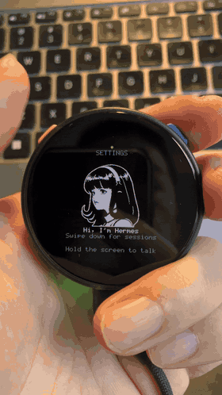

# M5Stack StopWatch × Hermes

> Give your Hermes Agent a body — on M5Stack StopWatch.

<p align="center">
  
  <br><sub>Voice conversation on M5Stack StopWatch. Latency is from the overseas LLM relay; local endpoints are faster.</sub>
</p>

The M5Stack StopWatch (ESP32-S3R8, 466×466 round CO5300 AMOLED) runs the
same Hermes Gadget firmware as any other supported board. This page covers
what is specific to the StopWatch port.

---

## Hardware

| Component | Detail |
|-----------|--------|
| SoC | ESP32-S3R8 |
| Flash | 16 MB |
| PSRAM | 8 MB OPI |
| Display | CO5300 466×466 round QSPI AMOLED |
| Touch | CST820 (I²C 0x15) |
| Audio codec | ES8311 (I²C 0x18) — mic + speaker |
| Amplifier | AW8737A (controlled via M5IOE1 PYG10) |
| I/O expander | M5IOE1 (I²C 0x4F) |
| PMIC | M5PM1 (I²C 0x6E) |

## Button mapping

| Button | Action |
|--------|--------|
| 🔵 Blue (right-top) | Hold to talk (PTT) / confirm in Settings |
| 🟡 Yellow (left-top) | Cancel / navigate in Settings |
| 🔴 Red (left-bottom, power) | Short press: sleep/wake display · Long press (~1.5 s): open/close Settings |

## Quick start

### 1. Build and flash

```bash
git clone https://github.com/allinnb/hermes-gadget-sdk
cd hermes-gadget-sdk/firmware/esp32

# Build (pure-ASCII path required on Windows — see note below)
python -m platformio run -e m5stack-stopwatch

# Flash (replace COM9 with your port)
python -m platformio run -e m5stack-stopwatch --target upload --upload-port COM9
```

> ⚠️ **Windows only:** ESP-IDF Kconfig scripts misparse non-ASCII directory
> names. Clone the repo into a path with only ASCII characters (e.g.
> `D:\projects\hermes-gadget-sdk`).

### 2. Configure Wi-Fi and pair

Connect a serial terminal (115200 baud) and run:

```
wifi-setup
```

Follow the prompts to enter your SSID and password. Once online:

```
set server ws://YOUR_SERVER_IP:8765/gadget
```

The display shows a pairing code. Approve it on the server:

```bash
hermes gadget pair --yes
```

### 3. Talk

Press and hold the **blue button**, speak, then release. Hermes replies
through the built-in speaker.

## What is new in this port

| Addition | File |
|----------|------|
| M5IOE1 I/O expander driver (power sequencing, amplifier, vibration) | `firmware/esp32/main/port_m5ioe1.{hpp,cpp}` |
| M5PM1 PMIC red-key driver (short press sleep/wake, long press Settings, IRQ) | `firmware/esp32/main/port_m5pm1.{hpp,cpp}` |
| StopWatch board config | `firmware/esp32/main/board.cpp` |
| Board Kconfig entry | `firmware/esp32/main/Kconfig.projbuild` |
| PlatformIO environment | `firmware/esp32/platformio.ini` |
| sdkconfig overrides | `firmware/esp32/boards/m5stack-stopwatch/sdkconfig.defaults` |

## Server deployment

See [`server/README.md`](server/README.md) for the full Hermes Agent
server setup guide, including LLM config, Piper TTS (Chinese), Whisper
STT, systemd unit, and device pairing.

## Debug bridge

[`tools/debug-bridge/`](tools/debug-bridge/) contains an HTTP-to-serial
bridge that lets a remote server send console commands to a USB-connected
StopWatch. Useful for diagnosing pairing and audio issues without physical
access to the device.

## Acknowledgements

- [RegeneratusLabs/physical-hermes](https://github.com/RegeneratusLabs/physical-hermes) — porting recipe and hardware Skill
- [Adolanium/hermes-gadget-sdk](https://github.com/Adolanium/hermes-gadget-sdk) — upstream SDK this port is based on
- [NousResearch/hermes-agent](https://github.com/NousResearch/hermes-agent) — the agent that runs on the server
- [facebookincubator/muse-gadget-sdk](https://github.com/facebookincubator/muse-gadget-sdk) — hardware reference (Apache-2.0; pin/register facts only, no code copied)

## Status

**Experimental** — passes physical hardware validation on one unit.
See [`docs/hardware-validation.md`](docs/hardware-validation.md) for the
full test report.
